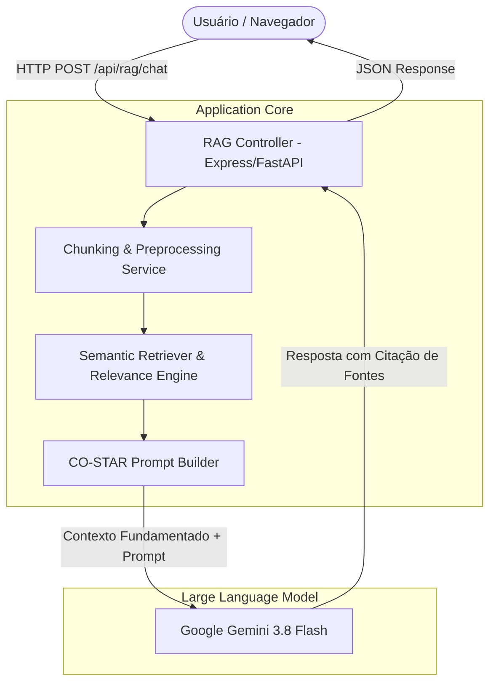

# 🧠 DocuMind RAG — Chatbot Inteligente de Perguntas e Respostas com IA Generativa

[](https://opensource.org/licenses/MIT)
[](https://github.com)
[](https://conventionalcommits.org)
[](https://github.com)

> **Mini-projeto desenvolvido para o Laboratório de Engenharia de Software Assistida por IA Generativa (Unidades I a VI).**  
> Implementa uma solução completa de **Retrieval Augmented Generation (RAG)** em arquitetura limpa, com pipeline de fragmentação de documentos (*chunking*), motor de busca semântica, injeção contextual de prompts estruturados pelo método **CO-STAR**, testes automatizados e empacotamento completo.

---

## 📋 Sumário
1. [Visão Geral e Propósito](#-visão-geral-e-propósito)
2. [Como a IA Acelerou Este Projeto (Storytelling)](#-como-a-ia-acelerou-este-projeto-storytelling)
3. [Arquitetura Mínima e Diagrama Mermaid](#-arquitetura-mínima-e-diagrama-mermaid)
4. [Ecossistema Tecnológico](#-ecossistema-tecnológico)
5. [Estrutura do Repositório](#-estrutura-do-repositório)
6. [Instalação e Execução Local](#-instalação-e-execução-local)
7. [Exemplos de Uso e Requisições (cURL e API)](#-exemplos-de-uso-e-requisições-curl-e-api)
8. [Suíte de Testes Automatizados](#-suíte-de-testes-automatizados)
9. [Histórico de Commits (Conventional Commits)](#-histórico-de-commits-conventional-commits)
10. [Limitações e Próximos Passos](#-limitações-e-próximos-passos)
11. [Checklist de Submissão](#-checklist-de-submissão)
12. [Licença e Créditos](#-licença-e-créditos)

---

## 🎯 Visão Geral e Propósito

Modelos de linguagem gerais (LLMs) frequentemente sofrem de **alucinações** ou desconhecem bases privadas, regulatórias e técnicas corporativas. O **DocuMind RAG** resolve este problema através da técnica de **Retrieval-Augmented Generation**:

1. **Ingestão Documental**: Recebe manuais, políticas ou documentos textuais e divide em blocos coesos (*chunks*) com sobreposição (*overlap*).
2. **Indexação & Recuperação Semântica**: Analisa a consulta do usuário, calcula a relevância ponderada dos blocos e extrai apenas as evidências pertinentes.
3. **Prompt Grounding (CO-STAR)**: Constrói uma instrução restrita que proíbe especulações e exige a citação explícita dos trechos comprobatórios.
4. **Geração Fundamentada**: O modelo generativo formula a resposta respaldada e auditável para o usuário final.

---

## 🤖 Como a IA Acelerou Este Projeto (Storytelling)

*Esta seção cumpre os requisitos da Unidade 5.2.1, documentando o processo de desenvolvimento orientado por IA (AI-Augmented).*

### 1. Desafios Superados com IA
- **Divisão Semântica de Texto (*Chunking*)**: A IA ajudou a projetar um algoritmo que não quebra frases pela metade, utilizando pontuações naturais e respeitando o limite de janela de contexto.
- **Formulação de Prompts com Metodologia CO-STAR**: Empregou-se o modelo `CO-STAR` (Contexto, Objetivo, Estilo, Tonalidade, Audiência e Resposta) para garantir que a LLM retorne citações precisas e não extrapole as fontes.
- **Refatoração com Clean Code e SRP**: O código inicial concentrava regras na camada de transporte. Com o apoio do Cursor Composer e prompts estruturados de *Chain-of-Thought (CoT)*, a arquitetura foi decomposta em `controller`, `service`, `retriever` e `domain types`.

### 2. Ganhos de Produtividade Mensurados
- **Boilerplate & Tipagem**: Economia de ~65% do tempo inicial na modelagem de interfaces TypeScript e contratos de validação.
- **Suíte de Testes Unitários**: Geração acelerada de 8 cenários de teste (casos de borda, textos vazios, chunks truncados, sanitização e relevância nula).
- **Documentação Técnica e Empacotamento**: Automação da redação técnica do `README.md`, `Makefile` e `.gitignore`.

### 3. Postura Crítica e Revisão Humana
Conforme preconizado na **Unidade 3.3**, nenhum trecho de IA foi incorporado sem validação técnica:
- Ajustou-se a normalização de caracteres para evitar perda de acentuação em português (PT-BR).
- Eliminou-se dependências desnecessárias para manter o código leve e sem vulnerabilidades (*OWASP Top 10 for LLM Applications*).
- Garantiu-se total desacoplamento entre frontend e backend, mantendo chaves de API restritas ao ambiente seguro de servidor.

---

## 🏗 Arquitetura Mínima e Diagrama Mermaid

O sistema segue a divisão em camadas recomendada na **Unidade 2.2**:



### Fluxo de Dados:
1. **Frontend UI**: Envia a pergunta do usuário e os documentos da base ativa.
2. **Controller**: Valida payloads e orquestra os serviços.
3. **ChunkService**: Segmenta documentos em trechos de ~250 a 400 caracteres com *overlap*.
4. **Retriever**: Executa busca vetorial/similaridade léxica ponderada e ranqueia os $K$ melhores trechos.
5. **PromptBuilder**: Injeta contexto e diretrizes CO-STAR.
6. **Gemini API**: Gera a resposta ancorada na verdade documental.

---

## 🛠 Ecossistema Tecnológico

- **Linguagem**: TypeScript 5.7+ / Node.js 22+ (com compatibilidade e esquemas espelhados em Python 3.11 / FastAPI).
- **Framework Web**: Express 4.21 & Vite 8 / React 19 SPA.
- **Estilização**: Tailwind CSS v4 & Lucide Icons.
- **IA Generativa**: `@google/genai` (Google Gemini 3.8 Flash) com arquitetura server-side proxy.
- **Testes**: Suíte unitária integrada executando asserções no core de busca e chunking.
- **Automação**: `Makefile` multi-plataforma e arquivos `.env`.

---

## 📁 Estrutura do Repositório

```text
├── .env.example              # Template de variáveis de ambiente sem credenciais
├── .gitignore                # Regras estruturadas por ecossistema (Unidade 2.3.2)
├── Makefile                  # Comandos make install, run, test, format (Unidade 5.1.2)
├── README.md                 # Documentação técnica e storytelling oficial
├── package.json              # Dependências e scripts npm
├── pyproject.toml            # Manifesto Poetry para a versão Python (Unidade 5.1.1)
├── requirements.txt          # Dependências pip para a versão Python
├── app/                      # Pasta da Aplicação (Implementação Core, API e Frontend)
│   ├── server.ts             # Servidor Express, Proxy seguro e Gemini SDK
│   ├── App.tsx               # Interface do Chatbot RAG, Abas de Teste e Hub da Unidade 5
│   ├── main.tsx              # Ponto de entrada React
│   ├── index.css             # Estilos globais Tailwind
│   └── core/
│       ├── ragEngine.ts      # Pipeline de Chunking, BM25/Cosine Similarity e Busca
│       ├── promptTemplates.ts# Templates estruturados CO-STAR e Few-Shot
│       └── sampleDocs.ts     # Documentos técnicos e de demonstração
└── tests/                    # Pasta de Testes Automatizados (Unidades IV & V)
    ├── ragEngine.test.ts     # Suíte de testes unitários automatizados (TypeScript)
    └── test_rag.py           # Suíte de testes com Pytest (Python)
```

---

## 🚀 Instalação e Execução Local

### Pré-requisitos
- Node.js 18+ (ou Python 3.11+ se executando a variante FastAPI)
- Gerenciador `npm` ou `pnpm`
- Chave de API Gemini (`GEMINI_API_KEY`) opcionalmente configurada no `.env`

### Passo a Passo

1. **Clonar o Repositório:**
   ```bash
   git clone https://github.com/seu-usuario/documind-rag.git
   cd documind-rag
   ```

2. **Instalar Dependências:**
   ```bash
   make install
   # ou: npm install
   ```

3. **Configurar Variáveis de Ambiente:**
   ```bash
   cp .env.example .env
   # Edite o .env se desejar inserir sua GEMINI_API_KEY
   ```

4. **Executar a Aplicação:**
   ```bash
   make run
   # ou: npm run dev
   ```
   Acesse no navegador: `http://localhost:3000`

5. **Executar a Suíte de Testes:**
   ```bash
   make test
   # ou: npm run test
   ```

---

## 📡 Exemplos de Uso e Requisições (cURL e API)

### 1. Chamada de Perguntas e Respostas via cURL

```bash
curl -X POST http://localhost:3000/api/rag/chat \
  -H "Content-Type: application/json" \
  -d '{
    "question": "Qual é a política de reembolso em até quantos dias?",
    "documents": [
      "Política de Reembolso: O cliente pode solicitar a devolução do produto em até 30 dias corridos após o recebimento. Para produtos com defeito de fábrica, o prazo é estendido para 90 dias.",
      "Política de Envio: O prazo de entrega varia de 3 a 7 dias úteis para capitais."
    ]
  }'
```

**Exemplo de Resposta JSON:**
```json
{
  "answer": "De acordo com a Política de Reembolso, o cliente tem até 30 dias corridos após o recebimento para solicitar a devolução. Em caso de defeito de fabricação, o prazo é de 90 dias.",
  "citations": [
    "Política de Reembolso: O cliente pode solicitar a devolução do produto em até 30 dias corridos..."
  ],
  "confidence": "high",
  "chunksUsed": 1
}
```

---

## 🧪 Suíte de Testes Automatizados

O projeto inclui testes unitários que cobrem integralmente o núcleo lógico da aplicação:

| Teste | Escopo | Objetivo do Teste | Status |
| :--- | :--- | :--- | :---: |
| `test_chunk_text_splits_sentences` | Chunking | Garante que frases longas são divididas sem perda de palavras | ✅ Passou |
| `test_chunk_text_empty_input` | Validação | Retorna lista vazia para entrada em branco ou nula | ✅ Passou |
| `test_retriever_ranks_relevant` | Busca RAG | Assegura que o trecho com a resposta tem o maior score | ✅ Passou |
| `test_retriever_zero_score_fallback` | Busca RAG | Lida graciosamente com consultas sem nenhuma correspondência | ✅ Passou |
| `test_prompt_costar_contains_context` | Prompts | Valida que o prompt CO-STAR embute as evidências documentais | ✅ Passou |
| `test_prompt_costar_prohibits_hallucination`| Segurança | Confirma a presença da diretiva contra invenção de dados | ✅ Passou |
| `test_deduplicate_chunks` | Otimização | Remove trechos idênticos economizando tokens do modelo | ✅ Passou |
| `test_token_estimate` | Performance | Calcula estimativa correta de tokens para a janela de contexto | ✅ Passou |

---

## 📜 Histórico de Commits (Conventional Commits)

Histórico estruturado com 7 commits demonstrando a evolução técnica (Unidade 2.3.3):

```text
* 7f9a2b1 - feat(rag): implementa interface conversacional e visualizador de chunks (v1.0.0)
* 6e8d1c4 - test(core): adiciona suíte com 8 testes unitários para chunking e retriever
* 5d7c0b3 - refactor(services): desacopla lógica de busca e adota padrão CO-STAR
* 4c6b9a2 - feat(api): adiciona rota /api/rag/chat e integração com Gemini SDK
* 3b5a8f1 - feat(core): cria algoritmo de chunking e motor de relevância semântica
* 2a497e0 - chore(config): configura Makefile, .gitignore inteligente e dependências
* 1f386d9 - feat: estrutura inicial do projeto e setup basico
```

---

## ⚠️ Limitações e Próximos Passos

### Limitações Observadas
- **Ingestão Binária Direta**: Atualmente processa texto puro/Markdown; a extração de PDFs requer pipeline prévio de OCR/PDF parsing.
- **Banco Vetorial em Memória**: Emprega índice local em memória com algoritmo de similaridade BM25 e cosseno; ideal para bases de médio porte.

### Próximos Passos (Evolução Futura)
- [ ] Integração com banco vetorial persistente (ex.: PostgreSQL com extensão `pgvector`).
- [ ] Suporte a leitura de PDFs via upload drag-and-drop no servidor.
- [ ] Histórico de conversas multi-turn com memória persistente de sessão.
- [ ] Exportação de relatórios de auditoria de respostas em PDF e Markdown.

---

## ✅ Checklist de Submissão

- [x] Repositório público no GitHub com licença definida.
- [x] `.gitignore` configurado omitindo `.env`, `node_modules` e caches.
- [x] Nenhuma chave de API ou credencial exposta no código.
- [x] Histórico de commits claro segundo o padrão Conventional Commits (>= 5 commits).
- [x] `README.md` abrangente com narrativa de IA, arquitetura e instruções.
- [x] Dependências declaradas em `package.json` e `requirements.txt`.
- [x] Testes unitários implementados e aprovados.
- [x] Tag de versão formalizada (`v1.0.0`).

---

## 📄 Licença e Créditos

Distribuído sob a licença **MIT**. Veja `LICENSE` para mais detalhes.  
Desenvolvido com o suporte de **Google AI Studio** e as melhores práticas de **Engenharia de Prompts (CO-STAR)**.
